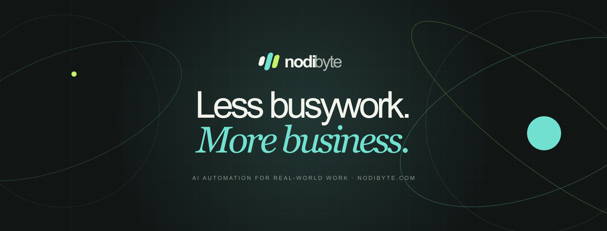

**AI automation and business software for Bangladesh.** We map how a business really works, then connect its tools into simple, automated systems: listen deeply, build simply, keep evolving.

## Products

| Product | What it does | Sign in |
|---|---|---|
| [Store Management](https://www.nodibyte.com/services/store-management) | Products, orders, stock, customers, dues (baki), bKash/Nagad, local couriers | [store.nodibyte.com](https://store.nodibyte.com) |
| [Pharmacy](https://www.nodibyte.com/services/pharmacy-management) | 39,000+ DGDA medicines built in, batch and expiry tracking, sell by piece/strip/box | [pharmacy.nodibyte.com](https://pharmacy.nodibyte.com) |
| [Restaurant POS](https://www.nodibyte.com/services/restaurant-pos) | Table bills, kitchen tickets and display, split bills, recipe-based stock | [restaurant.nodibyte.com](https://restaurant.nodibyte.com) |
| [Custom Apps](https://www.nodibyte.com/services/custom-app-development) | When your workflow doesn't fit a box, we build the app that fits | [Let's talk](https://www.nodibyte.com/lets-talk) |

Every product has a 14-day free trial, in English and বাংলা. See [pricing](https://www.nodibyte.com/pricing).

## Open source

- [`@nodibyte/bd-utils`](https://github.com/nodibyte/bd-utils): Bangladeshi mobile number validation and Bangla digit parsing. Zero dependencies. `npm i @nodibyte/bd-utils`

## Partners

Refer shops and earn 20% of their payments for 12 months: [nodibyte.com/partners](https://www.nodibyte.com/partners).

## Contact

[nodibyte.com](https://www.nodibyte.com) · [hello@nodibyte.com](mailto:hello@nodibyte.com) · [WhatsApp](https://wa.me/8801715768731) · [Facebook](https://facebook.com/nodibyte) · [YouTube](https://youtube.com/@nodibyte)
